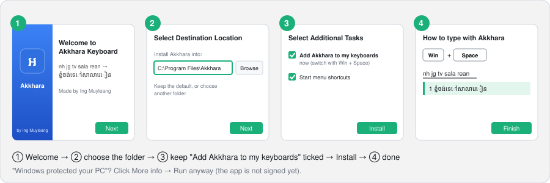
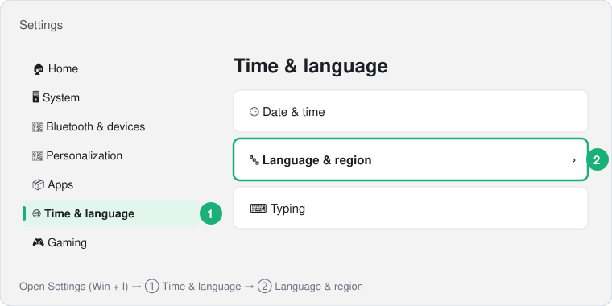
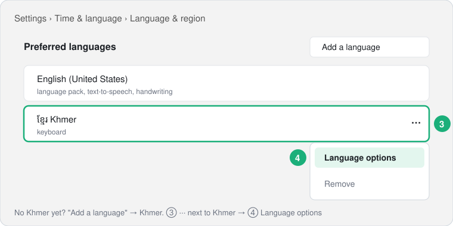
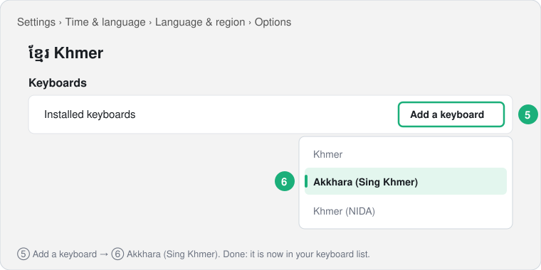
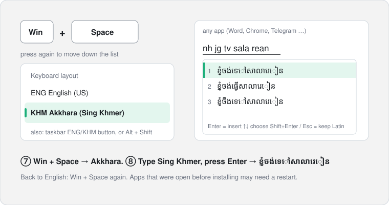

# Akkhara for Windows and Mac

Type **Sing Khmer** in any app and get **Khmer**: `nh jg tv sala rean` → **ខ្ញុំចង់ទៅសាលារៀន**

It uses the same AI model as the Akkhara phone keyboard
([akkhara-mini](https://huggingface.co/INGMUYLEANG/akkhara-mini), ONNX int8, 18.5 MB) and runs
**offline on your computer**; nothing you type is sent anywhere. Made by Ing Muyleang.

## Which file do I download?

From the [latest release](https://github.com/MuyleangIng/akkhara-desktop/releases/latest):

| Your computer | Download | What you get |
|---|---|---|
| **Windows 10 / 11** ⭐ recommended | **`Akkhara-Keyboard-Setup-….exe`** | a **real keyboard** next to English: Win + Space → Akkhara, type in any app |
| Mac (Apple M-series) | `Akkhara-Desktop-…-mac.zip` | test app: a hotkey opens a small window, Enter pastes the Khmer (a real Mac keyboard is coming) |
| Windows, no install | `Akkhara-Desktop-…-windows.exe` | the same test app for Windows; use Setup above if you can |

## Akkhara Keyboard for Windows 10 / 11

### Install with Setup (recommended)



1. Download **`Akkhara-Keyboard-Setup-….exe`** and open it.
   Windows may say *"Windows protected your PC"* (the app is new and not signed): **More info → Run anyway**.
2. **Welcome** → **License** (Apache-2.0) → **Next**.
3. **Choose the folder.** Keep the default `C:\Program Files\Akkhara` (recommended) or click **Browse** for
   another one.
4. Keep **"Add Akkhara to my keyboards now"** ticked (and the Start menu shortcuts if you like) → **Install**.
5. Setup shows a picture of how to type → **Finish**. Go to *Switch and type* below.

If Setup could not add the keyboard by itself, it tells you and opens Settings: then follow
*Add it by hand* below (it takes 1 minute).

### Add it by hand (if you unticked the box, or it is missing)

| | |
|---|---|
|  | **Win + I** opens Settings → ① **Time & language** → ② **Language & region** |
|  | No Khmer in the list? **Add a language** → *Khmer*. Then ③ **···** next to Khmer → ④ **Language options** |
|  | Under *Keyboards*: ⑤ **Add a keyboard** → ⑥ **Akkhara (Sing Khmer)** |

### Switch and type



| Key | What it does |
|---|---|
| **Win + Space** (or the ENG / KHM button on the taskbar, or Alt + Shift) | switch between English and Akkhara |
| type Sing Khmer | the Latin stays underlined; the top-5 Khmer appear under it |
| **Enter** | insert the highlighted Khmer |
| **↑ / ↓**, **Tab**, or click | choose another suggestion |
| **Shift + Enter** or **Esc** | keep exactly the Latin you typed |
| **Backspace** | edit what you typed |
| Ctrl / Alt shortcuts | work as usual |

Apps that were already open while installing may need a restart to see Akkhara.

### Uninstall

Settings → Apps → Installed apps → **Akkhara Keyboard** → Uninstall (or Start menu → Akkhara →
*Uninstall Akkhara Keyboard*). It removes Akkhara from your keyboard list, unregisters it and deletes
its folder. Files still used by open apps are deleted at the next restart.

Works in 64-bit and 32-bit apps on Intel/AMD PCs. Windows on ARM: not yet.

## Akkhara Desktop test app (Mac, or Windows without installing)

Download from the [latest release](https://github.com/MuyleangIng/akkhara-desktop/releases/latest):

**Windows 10 / 11:** `Akkhara-Desktop-…-windows.exe`
1. Double-click it. Windows may say *"Windows protected your PC"* (the app is new and not signed):
   click **More info → Run anyway**.
2. The first start takes a few seconds. The Akkhara window opens.

**Mac (Apple M-series):** `Akkhara-Desktop-…-mac.zip`
1. Unzip it and move **Akkhara** to *Applications*.
2. The first time, **right-click Akkhara → Open → Open** (the app is not signed by Apple).
   If macOS still blocks it: System Settings → Privacy & Security → **Open Anyway**.
3. To let Akkhara paste for you: System Settings → Privacy & Security → **Accessibility** → turn on
   **Akkhara**. Without it, the Khmer is copied and you press ⌘V yourself.

Then keep Akkhara running, go to any app and press the hotkey (below).

## Run from source (developers)

```bash
cd akkhara-desktop
uv venv --python 3.12 .venv && uv pip install --python .venv/bin/python -e .
bash scripts/get_model.sh              # model → models/akkhara-mini (skip if already copied)
.venv/bin/python -m akkhara_desktop    # Windows: .venv\Scripts\python -m akkhara_desktop
```

## Use it

| Key | What it does |
|---|---|
| **⌃⌥K** (Mac) / **Ctrl+Alt+K** (Windows) | open Akkhara from any app |
| type Sing Khmer | top-5 Khmer suggestions appear as you type |
| **Enter** | insert the highlighted suggestion |
| **↑ / ↓**, click, **Ctrl+1…5** | choose another suggestion |
| **Shift+Enter** | insert exactly what you typed |
| **Esc** | close without inserting |

Your old clipboard text is put back about 1 second after pasting.

**Mac, one time:** to let Akkhara press ⌘V for you, allow the app that runs it (Terminal, or
Python) in **System Settings → Privacy & Security → Accessibility**. Without it, the Khmer is only
copied and you press ⌘V yourself.

## How it works

```
any app ──hotkey──▶ Akkhara window ──▶ akkhara-mini (ONNX, CPU) ──▶ top-5 ──Enter──▶ clipboard + paste ──▶ any app
```

| File | What |
|---|---|
| `akkhara_desktop/engine.py` | the "brain": tokenizer, ONNX greedy + beam search, 6-word chunks + cache (same as the phone) |
| `akkhara_desktop/app.py` | the window (Tk): typing, suggestions, insert |
| `akkhara_desktop/platform_mac.py` | Mac: hotkey (Carbon), clipboard, ⌘V |
| `akkhara_desktop/platform_win.py` | Windows: hotkey, focus, clipboard, Ctrl+V (Windows API) |
| `tests/` | `python -m pytest -q` |

## License

Code: Apache-2.0 © 2026 Ing Muyleang. Model: [akkhara-mini](https://huggingface.co/INGMUYLEANG/akkhara-mini) (Apache-2.0).
